# The Modern look

An optional second look for FreeITSM: one calm, consistent frame for every module, the sign-in pages and the self-service portal, carrying **your** logo and brand colour. Switch it on in **System → Branding → Interface**. Classic, the standard FreeITSM look, stays the default and is not changed by any of this.

The Modern look was proposed upstream in [discussion #363](https://github.com/edmozley/freeitsm/discussions/363). The parts that make sense for everyone (design tokens beyond colour, a guard against new hard-coded colours, and module colours driving each module's accent) went into FreeITSM itself. The branded look is not part of FreeITSM for now, so it is maintained here, on this fork, and kept up to date with FreeITSM.

> All screenshots use a made-up organisation ("Harbour IT") and an empty test install.

## Classic and Modern

| Classic (the default) | Modern |
|---|---|
| 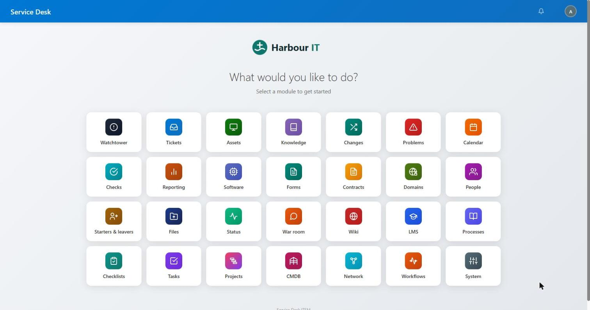 | 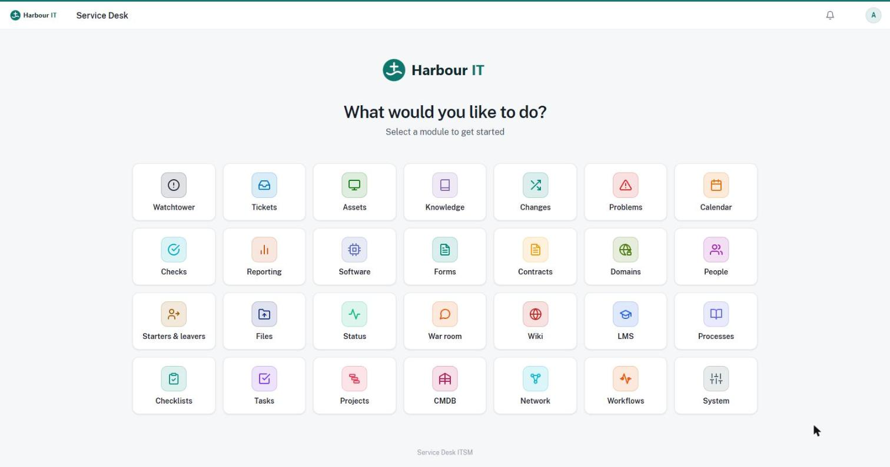 |

## What it looks like

**A module.** Every module gets the same light header with your logo. The module keeps its own colour as its identity: a thin strip along the top, a small square by its name, and its tile in the launcher. Buttons, links, tabs and selections use your brand colour.

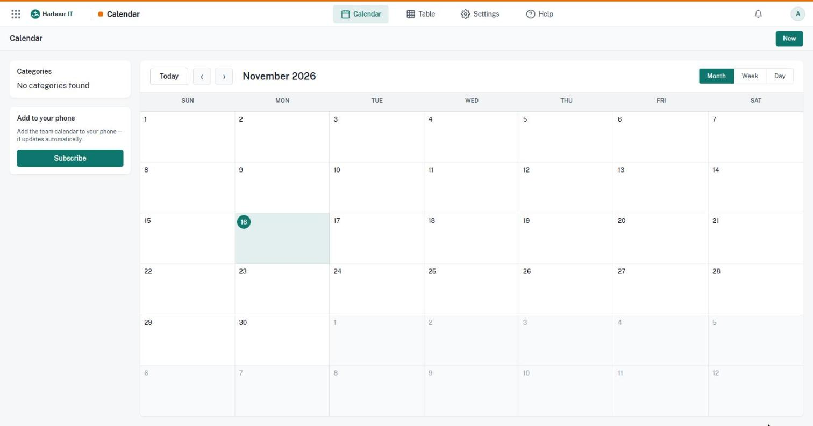

**Dark mode.** Light or Dark stays each person's own choice. A second logo for dark backgrounds is shown automatically.

| | |
|---|---|
| 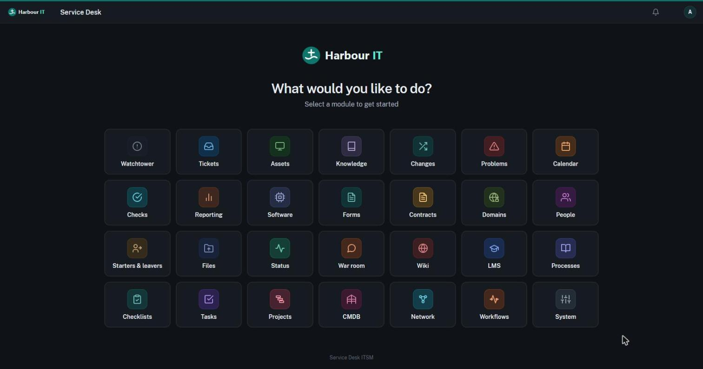 | 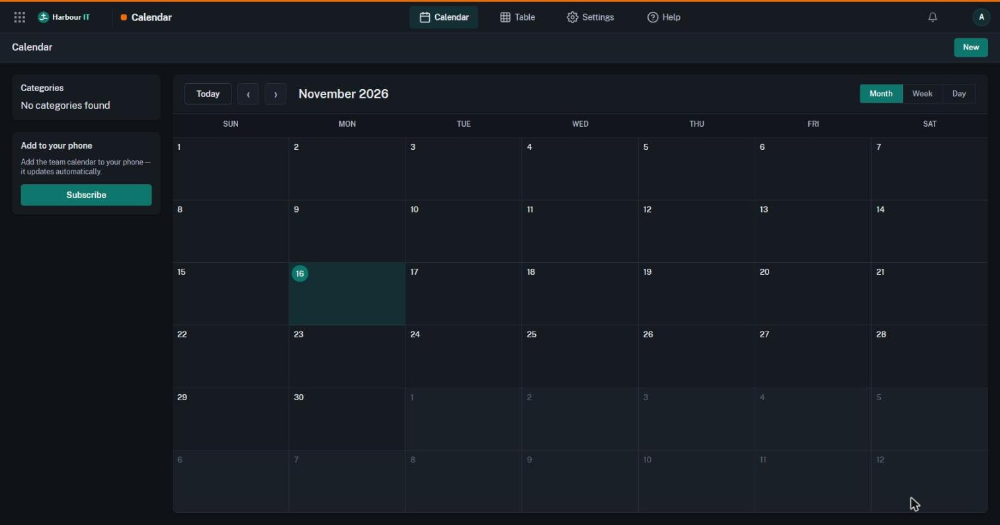 |

**The launcher.** Module tiles are tinted in each module's colour instead of solid gradients.

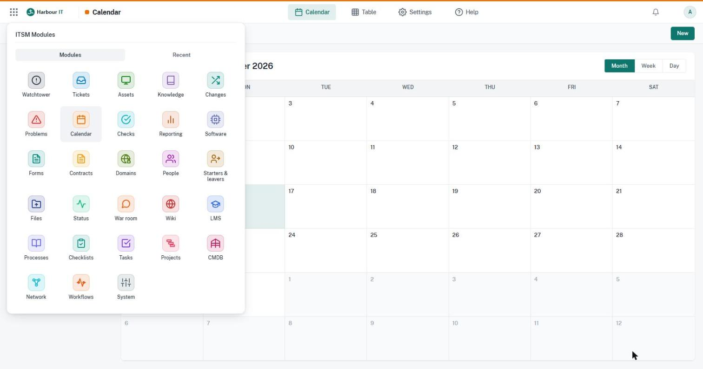

**Sign-in pages.** Analyst and portal sign-in, password and registration pages follow the same look.

| Analyst sign-in | Portal sign-in |
|---|---|
| 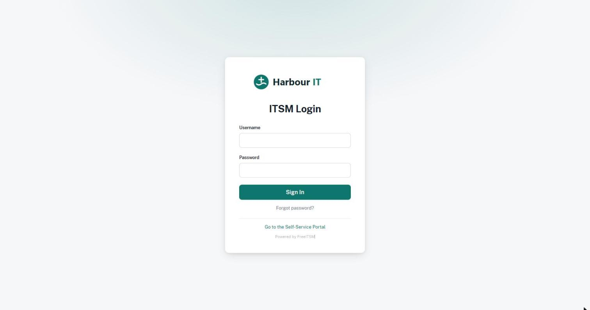 | 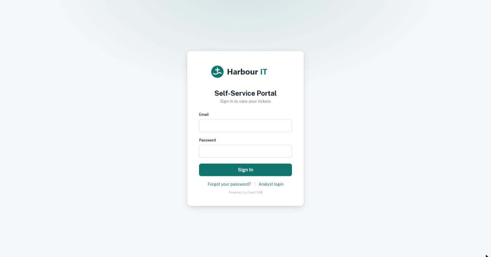 |

**The self-service portal.** The same light header and your brand colour, in light and dark.

| | |
|---|---|
| 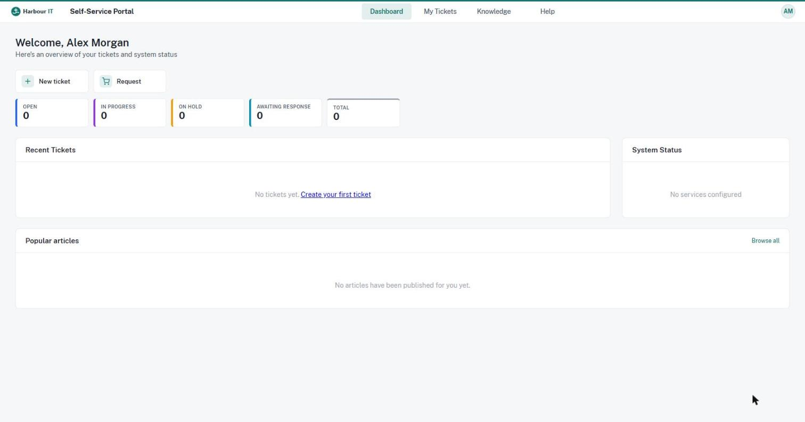 | 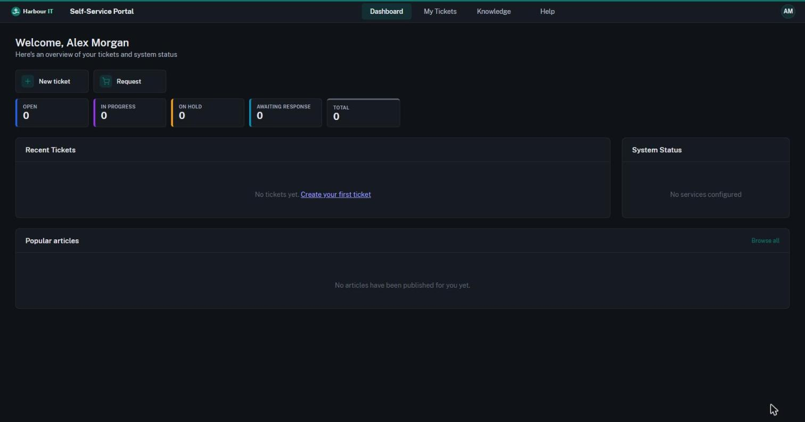 |

## Turning it on

**System → Branding → Interface**

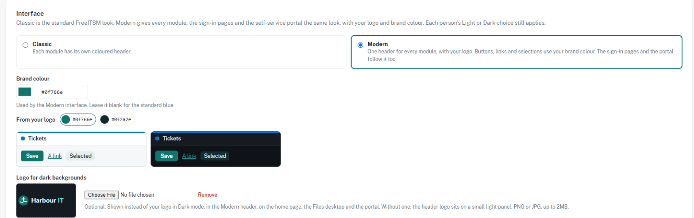

1. Choose **Modern**.
2. Pick a **brand colour**: type one such as `#0f766e`, use the picker, or click a colour suggested **From your logo** (read from your logo in your browser). Leave it blank for FreeITSM's standard blue.
3. Optionally upload a **logo for dark backgrounds**.
4. Press **Save**. Everyone sees it the next time a page loads.

The preview on the card shows your colour on a button, a link and a selection, in light and dark. If white text would be hard to read on your colour, Modern uses dark text or a deeper shade, so text on buttons and the colour used as text both reach a contrast of at least 4.5:1. A pale yellow brand is deepened rather than disappearing on white.

**To go back**, choose Classic and save. Nothing else changes.

## What it changes, and what it doesn't

| Area | In Modern |
|---|---|
| Module headers | One light header with your logo; the module's colour as a strip, a marker by its name and its launcher tile; quiet navigation tabs |
| Buttons, links, tabs, selections | Your brand colour (in the shared header and shared components) |
| Home page | Same header; tiles tinted in each module's colour |
| Sign-in pages | Analyst sign-in (including the MFA step), SSO confirm, forgot / reset / forced password change; the portal's sign-in, register, forgot, reset and email confirmation pages |
| Self-service portal | Same light header and brand colour; a portal header colour, if set, becomes the strip along the top |
| Logo in dark mode | Your dark logo replaces your organisation logo in the header, on the home page, the Files desktop and the portal. A company's own logo is never replaced |
| Narrow screens | On a phone a module's header shows its name (shortened with an ellipsis) instead of your logo; the home page keeps the logo and shrinks it. When the header runs short of room (tablets, narrow windows) the logo gives up space first, and icon-only navigation fades at the edge that has more buttons to scroll to. Sign-in cards use less padding on phones |
| Fonts | Public Sans and JetBrains Mono, bundled (SIL Open Font License, see `VENDOR.md`), never loaded from a third party |

**Left alone:**

- **Module content.** Modern styles the frame around each module, not every screen inside it. Content already uses FreeITSM's shared tokens, so it follows your colour where it uses them.
- **The sign-in designer.** Everything set in the designer below the Interface card still applies: a background you chose, the card style (solid, glass, flat), form and logo position, logo size, and the banner and footer strips. Only the designer's standard purple background is replaced by Modern's own; choose any other background to keep yours. The sign-in pages are always light, because nobody has signed in yet to have a preference.
- **Portal settings.** Logo, logo position and background pattern still apply.
- **Pop-out and print views** without the shared header stay as they are.
- **Classic.** With Classic selected, FreeITSM prints exactly what it always has, and none of the Modern stylesheets are loaded.

**Safety valve:** add `?nobranding=1` to a sign-in address to get the plain standard screen, whatever is set.

## How it works

For anyone reading or changing the code.

- **Setting.** Three `system_settings` rows: `branding_interface` (`classic` | `modern`), `branding_brand_primary` (`#rrggbb`) and `branding_logo_dark_path`. Only a validated value is ever printed, never CSS from the settings form. `includes/branding.php` reads and checks them (`brandingInterface()`), and works out the light and dark shades (`brandingDeriveAccent()`).
- **One hook per area,** each printing nothing with Classic:

  | Area | Hook | Stylesheets |
  |---|---|---|
  | Every module | `renderWaffleMenuButton()` → `renderModernShellHead()` (`includes/waffle-menu.php`), which every module header already calls | `modern-base.css`, `shell.css` |
  | Home page | `index.php` calls the same function | same |
  | Sign-in pages | `renderModernAuthHead()` after `<body>` | `modern-base.css`, `auth.css` |
  | Portal | `renderModernPortalHead()` in `self-service/includes/header.php` | `modern-base.css`, `portal.css` |

  Each sets `<html data-ui="modern" data-ui-page="app|auth|portal">`, links the stylesheets and prints the brand colours. Every Modern rule hangs on `:root[data-ui="modern"]`, so the stylesheets change nothing on a Classic page.
- **Stylesheets** in `assets/css/`: `modern-base.css` (fonts, tokens for light and dark, the brand accent, buttons, inputs), `shell.css` (analyst header, launcher, home), `auth.css` (sign-in pages), `portal.css` (portal header).
- **Built on FreeITSM's tokens.** Modern sets FreeITSM's own tokens in `theme.css` (`--surface`, `--text`, `--accent`, the type, spacing, radius and shadow tokens) to Modern values, and points every module's accent at the brand colour. No module page is edited.
- **Checks.** `tests/branding-interface.php` covers validation, contrast on pale and very dark colours, junk in the settings rows, each hook's output (and that Classic prints nothing), the sign-in background rule and the dark logo swap. FreeITSM's `tests/css-colour-guard.php` keeps hard-coded colours out of the Modern stylesheets.

## The `dev-modern-look` branch

| Branch on this fork | What it is |
|---|---|
| `dev` | FreeITSM `main` plus this fork's open pull requests to FreeITSM |
| `dev-modern-look` | `dev` plus the Modern look |

`dev-modern-look` is only ever merged into, never rebased or force-pushed, so a clone of it can keep pulling. It follows every FreeITSM release through `dev`. Install and run it the same way as FreeITSM (see the README).

## Questions and problems

- **About the Modern look** (how it looks, the Interface setting, the sign-in pages or portal in Modern): open an issue on [this fork](https://github.com/cloudcogsio/freeitsm/issues). Please say whether it also happens with Classic.
- **Anything that also happens with Classic** is a FreeITSM matter: report it on [FreeITSM](https://github.com/edmozley/freeitsm), not here.
- Please don't raise the Modern look on FreeITSM's own issues or discussions.
